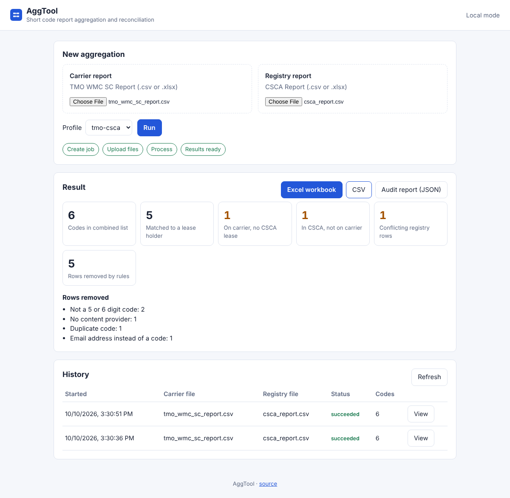
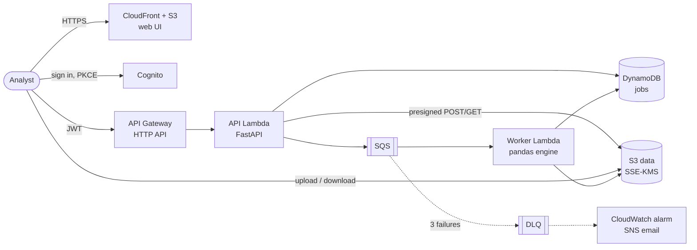

# AggTool

[](https://github.com/AaronVerdine/CTIA_AggTool/actions/workflows/ci.yml)


**Short code report aggregation and reconciliation, as a serverless AWS service.**

Mobile carriers and the Common Short Code Administration (CSCA) each keep their
own records of which SMS short codes are live and who is behind them. AggTool
combines a carrier report (e.g. T-Mobile's WMC SC Report) with the CSCA lease
report into one clean list:

| Short Code | Aggregator | Content Provider | Lease Holder |
|---|---|---|---|

It also reconciles the two: codes provisioned on the carrier with **no CSCA
lease**, leased codes **not on the carrier**, and **conflicting registry
entries**, with an audit trail explaining every row it removed.

This repository is a ground-up rebuild of a one-file pandas prototype
([`legacy/`](legacy/)). [docs/ASSESSMENT.md](docs/ASSESSMENT.md) explains what
the prototype got wrong; [docs/ARCHITECTURE.md](docs/ARCHITECTURE.md) explains
the design.



## Features

- **Rule engine driven by YAML profiles**: column aliases, join keys, filters and
  output layout are configuration ([example](src/aggtool/profiles/tmo_csca.yaml)).
- **Robust input handling**: CSV (any common delimiter or encoding) and Excel;
  finds the header row under banner rows; normalises `22222.0` and stray
  whitespace; clear errors naming the missing column.
- **Reconciliation and audit**: an Excel workbook with *Combined List*, *No
  Lease Holder*, *Not On Carrier*, *Registry Conflicts*, *Dropped Rows* and
  *Summary* sheets, plus a JSON audit report.
- **Safe outputs**: spreadsheet formula injection is neutralised.
- **Three interfaces**: web UI, REST API (OpenAPI docs at `/docs` locally) and CLI.
- **Production AWS deployment**: Cognito sign-in, direct-to-S3 uploads,
  queue-driven processing with retries and a dead-letter queue, KMS encryption,
  least-privilege IAM, alarms and a dashboard, all in Terraform, deployed by
  GitHub Actions over OIDC.

## Architecture



1. The browser creates a job and gets presigned S3 upload forms.
2. Files go straight to an encrypted S3 bucket; they never pass through the API.
3. Submitting the job queues it; the worker Lambda runs the engine and writes
   results back to S3.
4. The browser polls the job and downloads results through short-lived
   presigned links.

## Quick start (no AWS needed)

```bash
make install        # virtualenv + dev dependencies
make check          # lint, type check, 66 tests
make serve          # web UI and API at http://localhost:8000
```

Upload `samples/tmo_wmc_sc_report.csv` and `samples/csca_report.csv` to try it.

### CLI

```bash
aggtool run --primary samples/tmo_wmc_sc_report.csv \
            --lookup samples/csca_report.csv \
            --out combined.xlsx --report audit.json
# Wrote combined.xlsx: 6 codes (5 dropped, 1 without a lease holder, 1 registry codes not on carrier).

aggtool profiles                       # list built-in profiles
aggtool run ... --profile-file my.yaml # use a custom profile
```

### API

| Method | Path | Purpose |
|---|---|---|
| `GET` | `/health` | Liveness (public) |
| `GET` | `/profiles` | Available profiles |
| `POST` | `/jobs` | Create a job; returns presigned upload forms |
| `POST` | `/jobs/{id}/submit` | Queue the job once both files are uploaded |
| `GET` | `/jobs`, `/jobs/{id}` | Job history and status with summary |
| `GET` | `/jobs/{id}/download?artifact=xlsx\|csv\|report` | Presigned download link |

Every job belongs to the signed-in user; other users get `404`.

## Rules (from the original requirements)

| Requirement | Implementation |
|---|---|
| Output `Short Code \| Aggregator \| Content Provider \| Lease Holder` | `output` in the profile |
| `Start Application Addresses` → Short Code, `Provider Name` → Aggregator | `primary.columns` aliases |
| CSCA `Company` → Lease Holder, far right | `lookup.columns`, joined **by short code** |
| Remove duplicates | `deduplicate` (applied last, so a complete row beats an earlier blank one) |
| Remove 3, 4, 7, 8+ digit codes | `allowed_code_lengths: [5, 6]` |
| Remove email addresses | `drop_emails`, plus `numeric_only` |
| Remove codes with no Content Provider | `require_fields: [content_provider]` |

Each rule has its own unit test in [tests/test_engine.py](tests/test_engine.py).

## Security

Data is treated as **business-confidential, not regulated** (no PII, PHI or
payment data), but the controls a regulated workload needs are in place:
customer-managed KMS encryption for S3, DynamoDB, SQS, SNS and logs; TLS-only
bucket policies; invite-only Cognito with MFA available; per-user job
isolation; per-function least-privilege IAM; upload size limits enforced by S3;
automatic deletion of uploads (7 days) and results (30 days); and OIDC
deployment with no stored AWS keys. See [docs/ARCHITECTURE.md](docs/ARCHITECTURE.md#3-security-design).

## Deploy to AWS

See [docs/DEPLOYMENT.md](docs/DEPLOYMENT.md). Estimated cost at demo scale is
about $1–3 per month.

## Project layout

```
src/aggtool/        engine, profiles, API, Lambda handlers, CLI
tests/              unit, API and AWS (moto) tests
web/                static web UI (no build step)
infra/bootstrap/    one-time: Terraform state bucket, GitHub OIDC deploy role
infra/terraform/    the application stack
.github/workflows/  CI (lint, types, tests, Terraform, Checkov) and deploy
legacy/             the original prototype, for comparison
```

## License

MIT
